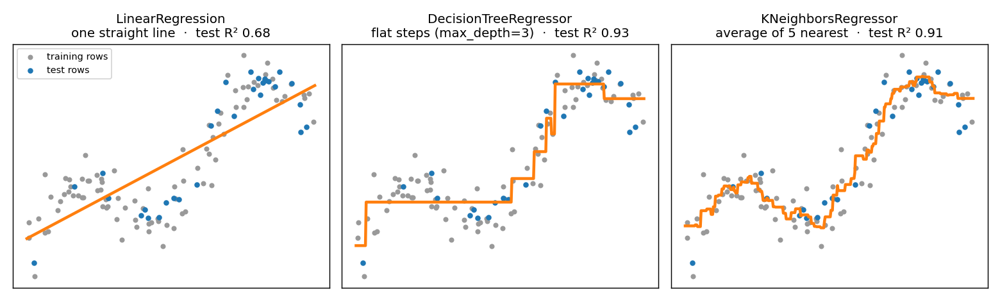
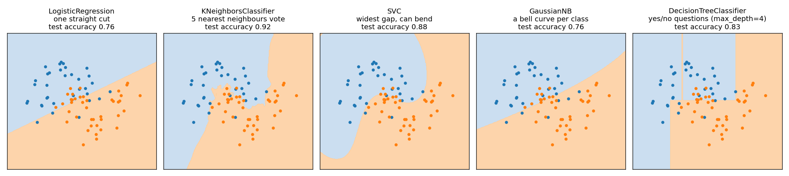
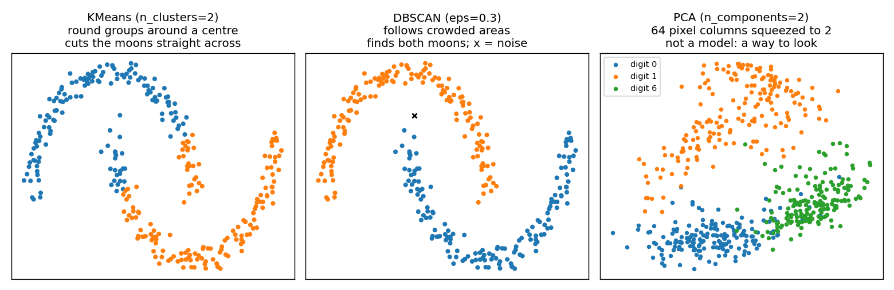

# Choosing a model cheat sheet

Which model to use, when to use it, and where in your code the choice
happens.

## The short answer

You do not pick the right model by staring at a list. You do it in two moves:

1. **Shortlist.** Three questions about your data cut a dozen models down to
   two or three.
2. **Test.** Try every model on the shortlist with the same five lines of
   code, on the same test rows. The scores pick the winner, not you.

Trying a second model costs one changed line. Guessing wrong costs nothing,
as long as you test.

## Question 1: what are you trying to find out?

Say the question out loud as a sentence. The sentence tells you the family.

| The question you would say | Is there an answer column? | What kind of answer | Family |
|---|---|---|---|
| How many bikes will be rented tomorrow? | Yes: `cnt` | a number | **regression** |
| What price will this house sell for? | Yes: the price | a number | **regression** |
| Will this passenger survive? | Yes: `Survived` | one of a fixed list (yes, no) | **classification** |
| Which digit is in this picture? | Yes: the digit | one of a fixed list (0 to 9) | **classification** |
| What kinds of customers do we have? | No | groups nobody has named yet | **clustering** |
| Can I see 64 columns in one picture? | No | a 2-D view of the data | **PCA** (a way to look, not a model) |

**Number or category?** Some categories are stored as numbers: the digit
0 to 9, `weathersit` 1 to 3, `Survived` 0 or 1. Ask yourself: *does halfway
make sense?* Halfway between 2 and 4 bikes is 3 bikes, so `cnt` is a number.
Halfway between a picture of a 2 and a picture of a 4 is not a picture of a
3, so the digit is a category.

**Supervised or unsupervised?** If you have an answer column to learn from,
it is *supervised* learning (regression and classification). If you do not,
it is *unsupervised* (clustering and PCA).

## Question 2: which one from the family?

Each picture below is a real run on made-up data. Each model sees the same
training rows and is scored on the same test rows. Look at the *shape* each
one draws: that shape is how the model thinks.

### When the answer is a number



The data curves, so the straight line misses the bends. That is a property
of this data, not a verdict on the model: on data that rises in a straight
line, the straight line is often the best choice.

| Model | How it thinks | Pick it when | Watch out for | Scale first? | Explains why? |
|---|---|---|---|---|---|
| `LinearRegression` | one straight line | the pattern is roughly straight, or you want "each extra unit adds this much" | curves it cannot bend to | no | yes: coefficients |
| `DecisionTreeRegressor` | flat steps, from yes/no questions | the pattern curves or jumps, or you want rules | a deep tree memorises the training rows: set `max_depth` | no | yes: rules |
| `KNeighborsRegressor` | the average of the nearest rows | a few columns and a curvy pattern | columns on different scales; slow on many rows | **yes** | no |

### When the answer is a category



The blue and orange dots are test rows. The shaded background is what each
model would predict for a new point landing there.

| Model | How it thinks | Pick it when | Watch out for | Scale first? | Explains why? |
|---|---|---|---|---|---|
| `LogisticRegression` | one straight cut, with a probability for each side | your first try on any category question | groups that curve round each other | helps | yes: coefficients |
| `KNeighborsClassifier` | the nearest rows vote | a few columns, oddly shaped groups | columns on different scales; slow on many rows | **yes** | no |
| `SVC` | the widest gap between the groups, and the gap can bend | many columns of the same kind, such as pixels | slow once rows run into tens of thousands | **yes** | no |
| `GaussianNB` | a bell curve for each column, in each group | a fast first baseline, small data | columns that rise and fall together fool it | no | no |
| `DecisionTreeClassifier` | a chain of yes/no questions | you must explain the decision, or columns are a mix of kinds | memorising the training rows: set `max_depth` | no | yes: rules |

### When there is no answer column



| Technique | How it thinks | Pick it when | Watch out for | Scale first? |
|---|---|---|---|---|
| `KMeans` | round groups, each around a centre | you can say how many groups you want, and expect them to be roundish | you choose `n_clusters`; every point is forced into a group | **yes** |
| `DBSCAN` | groups are crowded areas, gaps between them | the groups have odd shapes, or you want to spot outliers (label `-1`) | you choose `eps`; groups of very different crowdedness | **yes** |
| `PCA` | squeezes many columns into a few new ones | too many columns to plot, or to speed up a later model | the new columns are mixtures and hard to name | **yes** |

## Question 3: anything that rules a model out?

| If this is true | Then |
|---|---|
| You must explain *why* to a person | a decision tree (read the rules) or logistic / linear regression (read the coefficients) |
| Columns are on very different scales | scale before K-NN, SVC, K-means, DBSCAN and PCA, or leave them out. Trees do not care |
| Too many columns to look at | PCA first, to see the data in 2-D |
| One kind of mistake costs far more than the other | judge by that mistake, not by accuracy (see below) |

## Where the choice happens in your code

The order of a modelling notebook never changes. The model is one line in
the middle.

| Step | Code | Changes when you change model? |
|---|---|---|
| 1. Load and clean | `pd.read_csv`, fill gaps, turn text into numbers | no |
| 2. Choose columns | `X = ...` and `y = ...` | no |
| 3. Split | `train_test_split(X, y, random_state=1)` | no |
| 4. Scale, if the model measures distance | `StandardScaler`, fitted on the training rows only | sometimes |
| 5. **Pick the model** | `model = KNeighborsClassifier()` | **this is the only line** |
| 6. Fit | `model.fit(X_train, y_train)` | no |
| 7. Score | `model.score(X_test, y_test)` | no |

Here are the seven steps on the two-moons data from the picture above. K-NN
measures distance, so step 4 is in.

```python
from sklearn.datasets import make_moons
from sklearn.model_selection import train_test_split
from sklearn.preprocessing import StandardScaler
from sklearn.neighbors import KNeighborsClassifier

# Steps 1 and 2: made-up data, two columns, answer 0 or 1
X, y = make_moons(n_samples=300, noise=0.3, random_state=1)

# Step 3: keep a quarter of the rows back for the test
X_train, X_test, y_train, y_test = train_test_split(X, y, random_state=1)

# Step 4: learn the scaling from the training rows only, then use it on both
scaler = StandardScaler()
scaler.fit(X_train)
X_train_scaled = scaler.transform(X_train)
X_test_scaled = scaler.transform(X_test)

# Step 5: the only line you change to try another model
model = KNeighborsClassifier()

# Steps 6 and 7
model.fit(X_train_scaled, y_train)
print("accuracy on the test rows:", round(model.score(X_test_scaled, y_test), 2))
```

```
accuracy on the test rows: 0.92
```

`score` gives **accuracy** for a category (the share of test rows it got
right) and **R²** for a number (1 is perfect, 0 is no better than guessing
the average every time).

## One script, every model

Because only step 5 changes, put the shortlist in a dictionary and loop.
Both columns of the two-moons data already sit on the same scale, so this
loop skips scaling.

```python
from sklearn.datasets import make_moons
from sklearn.model_selection import train_test_split
from sklearn.linear_model import LogisticRegression
from sklearn.neighbors import KNeighborsClassifier
from sklearn.svm import SVC
from sklearn.naive_bayes import GaussianNB
from sklearn.tree import DecisionTreeClassifier

X, y = make_moons(n_samples=300, noise=0.3, random_state=1)
X_train, X_test, y_train, y_test = train_test_split(X, y, random_state=1)

models = {
    "Logistic regression": LogisticRegression(),
    "K-NN":                KNeighborsClassifier(),
    "SVC":                 SVC(),
    "Naive Bayes":         GaussianNB(),
    "Decision tree":       DecisionTreeClassifier(max_depth=4, random_state=1),
}

for name in models:
    model = models[name]
    model.fit(X_train, y_train)
    print(name, "accuracy:", round(model.score(X_test, y_test), 2))
```

```
Logistic regression accuracy: 0.76
K-NN accuracy: 0.92
SVC accuracy: 0.88
Naive Bayes accuracy: 0.76
Decision tree accuracy: 0.83
```

These are the same numbers as in the picture. On this made-up data K-NN
comes first. On different data the order changes, which is why you test
instead of guessing.

For a number, swap in `LinearRegression()`, `DecisionTreeRegressor()` and
`KNeighborsRegressor()`. The loop stays the same.

## How to pick the winner

1. **Beat the lazy guess first.** For a category, the lazy guess is "always
   the most common answer". For a number, it is "always the average". A
   model that cannot beat that is worth nothing.
2. **Same split for everyone.** Compare models on the same test rows, with
   the same `random_state`, or the comparison is not fair.
3. **Ask which mistake costs more.** A missed cancer is far worse than a
   false alarm. Count that mistake for each model, as well as accuracy.
4. **Close scores? Take the simpler one.** If a straight line is nearly as
   good as anything else, it is the one you can explain.
5. **Too good to be true usually is.** A near-perfect score often means the
   answer is hidden in a feature. Ask: *would I know this column before I
   need the prediction?*

## The ML challenge, through the three questions

| Dataset | Question 1: what kind? | Shortlist | What decided it |
|---|---|---|---|
| Handwritten digits | category, 10 options | K-NN, SVC, logistic regression, naive Bayes, tree | 64 pixel columns on one scale: test them all, no scaling needed |
| Breast cancer | category, 2 options | logistic regression, naive Bayes, K-NN, SVC, tree | columns on very different scales, so scale for K-NN and SVC; judge by missed cancers |
| Titanic | category, 2 options | small decision tree, logistic regression | the question asks *why*, so both must explain themselves |
| Bike share, by day | number | linear regression, tree regressor, K-NN regressor | R² and "off by how many bikes"; watch for leakage from `casual` and `registered` |

## Words you will see

| Word | Plain meaning |
|---|---|
| classifier | a model that predicts a category (`...Classifier`, `SVC`, `LogisticRegression`) |
| regressor | a model that predicts a number (`...Regressor`, `LinearRegression`) |
| hyperparameter | a setting you choose before fitting, such as `n_neighbors`, `max_depth`, `n_clusters` |
| baseline | the lazy guess, or the simplest model, that everything else must beat |
| overfitting | the model memorised the training rows and does worse on new rows |

`LogisticRegression` has "regression" in its name but predicts a category.
Go by what it predicts, not by its name.
